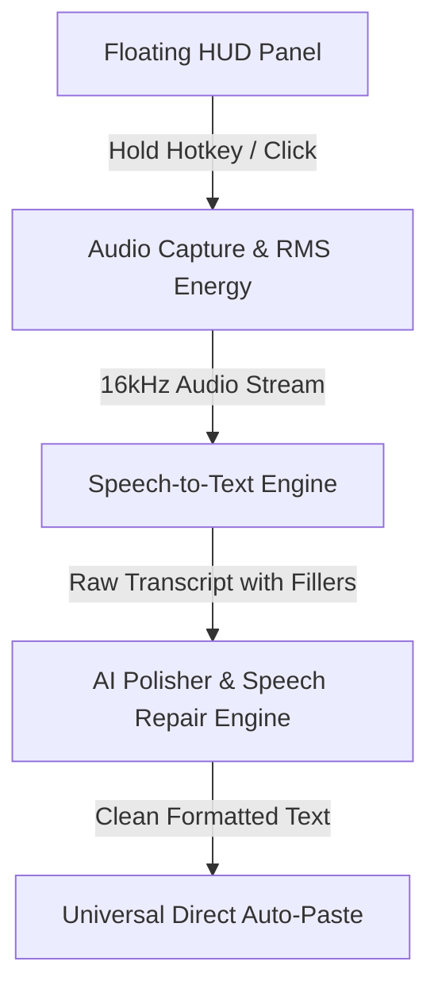

# 🎙️ Flow Widget — AI Voice Dictation Capsule for macOS

A native macOS floating capsule widget for seamless, system-wide AI voice dictation and real-time speech repair.

---

## 🏗️ Architecture & Core Pipeline

Flow Widget provides an intelligent, non-intrusive voice dictation system built natively for macOS across **5 distinct architectural layers**:



### 1. The Non-Activating Floating Panel
* **Challenge:** Standard macOS windows steal focus from whatever application the user is currently typing in (Slack, Chrome, VS Code, Notes).
* **Solution:** Uses an `NSPanel` configured with `.nonactivatingPanel` style mask and `.floating` window level. The user can interact with the widget or view live audio feedback without their typing cursor ever losing focus from their active text editor.

### 2. Audio Capture & Waveform Visualizer
* **Pipeline:** Utilizes `AVAudioEngine` tapping into the default microphone input bus (`inputNode`).
* **Energy Calculation:** Computes the Root Mean Square (RMS) energy in real-time from the raw audio buffer:
  $$\text{RMS} = \sqrt{\frac{1}{N} \sum_{i=1}^N x[i]^2}$$
* This normalizes into dynamic heights driving the 7-bar audio waveform animation.

### 3. Speech Recognition (ASR)
* Built-in support for **Apple's native `SFSpeechRecognizer`**:
  * 100% free, runs offline on Apple Silicon / macOS.
  * Zero latency, no external API keys required.
* Optional integration hook for cloud speech recognition (OpenAI Whisper / Groq) for high-entropy multi-language dictation.

### 4. Speech Repair & Polishing Engine
Raw spoken dictation naturally contains hesitations, stutters, false starts, and repeated words:
* *Raw input:* `"hey um can we meet uh tomorrow at like 2 wait no 3 pm thanks"`
* *Polished output:* `"Hey, can we meet tomorrow at 3:00 PM? Thanks."`

The engine applies a dual-mode approach:
1. **Zero-Latency Local Engine:** High-performance rule-based pipeline that strips filler words (`um`, `uh`, `like`), resolves human speech self-corrections (`X wait no Y` $\rightarrow$ `Y`), formats numbers/times/currencies, and handles punctuation and capitalization.
2. **Cloud LLM Engine:** Integrates with OpenAI-compatible endpoints (Groq, OpenAI, Ollama) using structured dictation prompts for advanced contextual polishing.

### 5. Universal Direct Injection (Auto-Paste)
* Once the text is polished, it writes the formatted string into `NSPasteboard.general`.
* It then synthesizes an OS-level keyboard event:
  $$\text{Cmd} + \text{V}$$
  via `CGEvent(keyboardEventSource: nil, virtualKey: 0x09, keyDown: true)` posted directly to `kCGHIDEventTap`.
* This automatically pastes the cleaned text directly into whichever application has active focus.

---

## 🚀 How to Run the Native macOS App

### 1. Build and Bundle from Source:
```bash
git clone https://github.com/reyanshcollegeproject-glitch/flow-widget.git
cd flow-widget
bash package_app.sh
open ./FlowWidget.app
```

### 2. Required macOS Permissions:
1. **Microphone Access:** macOS will prompt on first launch to allow microphone access.
2. **Accessibility (For Auto-Paste):** To allow Flow Widget to simulate `Cmd + V` into other apps, grant permission in:
   * **System Settings $\rightarrow$ Privacy & Security $\rightarrow$ Accessibility** $\rightarrow$ Enable **Flow Widget**.
   * *(If not enabled, the text is still copied to your clipboard, and you can press `Cmd + V` manually).*

---

## 📝 Automatic Notes Sync

Every voice recording and polished text is **automatically saved**:

1. **Apple Notes.app:**
   * Directly appends into macOS **Notes.app** in a note titled **"Flow Voice Dictations"** with timestamp and mode.
2. **Dedicated Markdown Notes File:**
   * Saved locally to `Flow_Notes.md` and `~/Documents/Flow Notes.md`.
3. **Menu Bar Shortcuts:**
   * Click the menu bar icon $\rightarrow$ **"📝 Open in Apple Notes"**
   * Click the menu bar icon $\rightarrow$ **"📄 Open Flow Notes.md"**

---

## 🌐 Interactive Web Simulator & Playground

You can also run the web playground in your browser:

```bash
open ./web-demo/index.html
```

Features:
* Web Audio API real-time microphone waveform visualizer.
* Interactive Speech Recognition in browser.
* Live sample test buttons to experiment with self-corrections and filler word removal.
